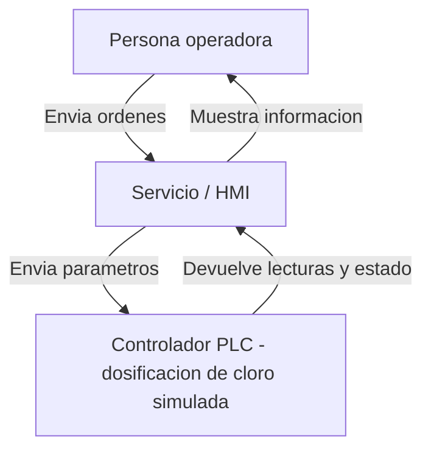

## Hallazgo y decisión
Hallazgo: Gitleaks detectó una credencial de fábrica expuesta en el historial de commits del archivo config-yaml (Linea 1).
Gravedad: Alta.
Desición y justificación: Postergar. La contraseña ya fue retirada de la versión actual del código y reemplazada por la variable segura PLC_PASSWORD. Sin embargo, como sigue siendo visible en el historial del repositorio, se requiere un procedimiento técnico especializado para limpiar el historial de Git sin romper el sistema.
Responsable y fecha: Matias Sepúlveda, 09-10-2026.

## Tres amenazas

1. **Acceso no autorizado al PLC:** Suplantación (Spoofing). Un atacante podría utilizar una credencial expuesta para modificar la dosificación de cloro y afectar la calidad del agua. Control: Gitleaks y gestión de secretos.

2. **Modificación no autorizada de parámetros:** Manipulación (Tampering). Una alteración de los parámetros del PLC podría provocar una dosificación incorrecta de cloro. Control: validación de parámetros y control de cambios.

3. **Interrupción de comunicación HMI-PLC:** Denegación de servicio (DoS). El operador podría perder temporalmente la supervisión del proceso. Control: monitoreo, alertas y medidas de continuidad operacional.

## Diagrama del sistema

