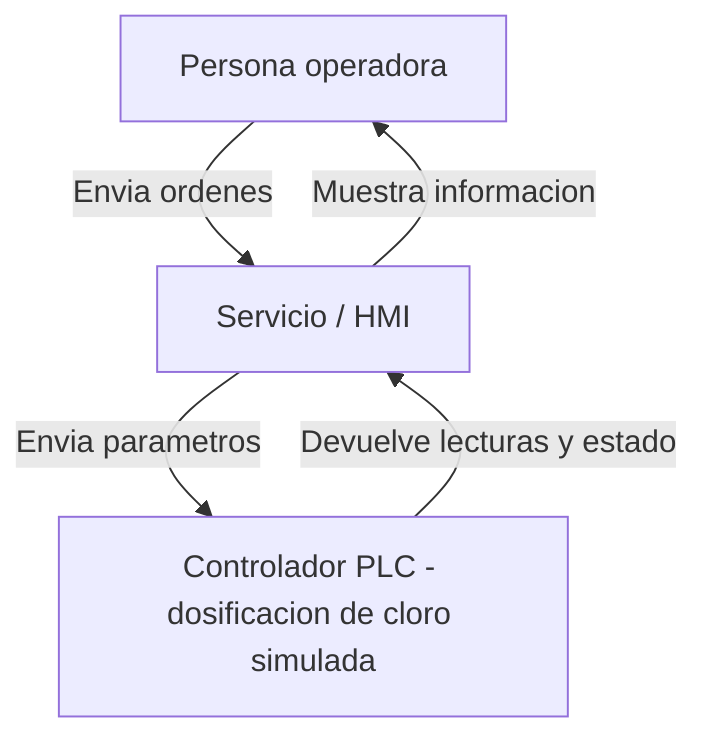

## Diagrama del sistema

## Hallazgo y decisión
Hallazgo: Gitleaks detectó una credencial de fábrica expuesta en el historial de commits del archivo config-yaml (Linea 1).
Gravedad: Alta.
Desición y justificación: Postergar. La contraseña ya fue retirada de la versión actual del código y reemplazada por la variable segura PLC_PASSWORD. Sin embargo, como sigue siendo visible en el historial del repositorio, se requiere un procedimiento técnico especializado para limpiar el historial de Git sin romper el sistema.
Responsable y fecha: Matias Sepúlveda, 09-10-2026.

## Tres amenazas

1. **Acceso no autorizado al PLC:** Suplantación (Spoofing). Un atacante podría utilizar una credencial expuesta para modificar la dosificación de cloro y afectar la calidad del agua. Control: Gitleaks y gestión de secretos.

2. **Modificación no autorizada de parámetros:** Manipulación (Tampering). Una alteración de los parámetros del PLC podría provocar una dosificación incorrecta de cloro. Control: validación de parámetros y control de cambios.

3. **Interrupción de comunicación HMI-PLC:** Denegación de servicio (DoS). El operador podría perder temporalmente la supervisión del proceso. Control: monitoreo, alertas y medidas de continuidad operacional.

## Sistema y equipo

- Sector: Agua potable.
- Nombre: Planta Maipo Sur (laboratorio simulado).
- Sistema: Lectura y supervisión ficticia de cloro mediante HMI y PLC.
- Roles: Equipo de desarrollo, revisión de seguridad y operación simulada.

## Controles ejecutados

- Gitleaks: detección de secretos en el repositorio.
- Semgrep: análisis estático de código Python.
- Trivy: análisis de configuración Terraform.
- OSV-Scanner: revisión de dependencias declaradas.
- Prueba funcional: lectura simulada de cloro.
- SBOM: inventario de componentes generado en formato CycloneDX.

### Resultados

- Prueba funcional: exitosa.
- Semgrep en main: 0 hallazgos con las 2 reglas configuradas.
- Trivy: 1 archivo Terraform detectado y 0 configuraciones inseguras reportadas.
- OSV-Scanner: ejecución correcta; 0 paquetes externos encontrados.
- SBOM: artefacto `sbom-planta-maipo-sur` generado en GitHub Actions.

## Auditoría del parche de IA

Pull Request #1:
https://github.com/Pinguinitoo/planta-maipo-sur/pull/1

Rama: propuesta-ia.

### Paquete verificado
El parche menciona `plc_helper_utils`, pero no se ha verificado su procedencia ni confiabilidad.

### Tratamiento de entradas
Se identificó `subprocess.run(comando, shell=True)`, que permite interpretar entradas no confiables como comandos.

### Protecciones desactivadas
Se identificó `verify=False`, que desactiva la validación del certificado TLS.

### Destino de datos
El parche intenta enviar información a `https://telemetria-no-autorizada.invalid`, un destino ficticio no autorizado.

### Veredicto y evidencia
RECHAZADO. No fusionar el Pull Request con main.

Semgrep detectó 2 hallazgos bloqueantes en el parche y el workflow terminó con código de salida 1.

## Pendientes para un sistema real

- Eliminar de forma segura la credencial expuesta en el historial de Git y rotarla si correspondiera a una credencial real.
- Validar y limitar los parámetros de dosificación.
- Aplicar controles de acceso y autenticación al PLC y HMI.
- Implementar monitoreo, alertas y continuidad operacional.
- Verificar dependencias y destinos externos antes de incorporarlos.
- Mantener pruebas y análisis de seguridad en cada cambio.
- Realizar pruebas de seguridad operacional antes de cualquier despliegue real.

## Evidencias

- Repositorio:
  https://github.com/Pinguinitoo/planta-maipo-sur

- GitHub Actions:
  https://github.com/Pinguinitoo/planta-maipo-sur/actions

- Auditoría del parche de IA:
  https://github.com/Pinguinitoo/planta-maipo-sur/pull/1

- SBOM:
  Artefacto `sbom-planta-maipo-sur` disponible en GitHub Actions.
